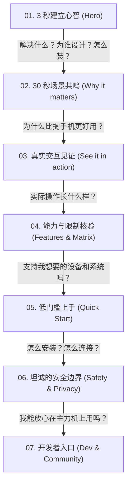

# MenuBarMijia README 架构与叙事重构说明书 (README_STRUCTURE)

> **文档版本：** v1.0 · 2026-10-30  
> **适用版本基线：** MenuBarMijia `v1.1.4`  
> **服务目标：** 阐明新版中英文 README 的信息架构（IA）、叙事逻辑、标语决策以及现有内容的迁移策略。

---

## 1. 核心叙事主线与读者心理动线

### 唯一叙事主线
> **“无需拿起手机，在电脑上自然地控制米家。”**

过去版本的 README 存在典型的“技术百科全书”倾向：从首屏开始堆砌大量技术细节（零 Swift 依赖、RC4 传输层加密、Miot-Spec、Jev 结构化并发决策、CI 发布管道等），导致普通用户（占 70% 的目标群体）产生“这是极客开发工具还是日常应用？”的疑惑。

重构后的叙事逻辑严格按照用户的“认知与决策漏斗”推进：

---

## 2. 首页标语（Slogan）候选方案与决策

根据任务书要求，针对首屏定位提炼了 4 套候选标语方案：

| 方案编号 | 主标语（Slogan） | 副标说明（Sub-headline） | 风格倾向 | 适用场景分析 |
| :---: | :--- | :--- | :--- | :--- |
| **方案 A （推荐）** | **在电脑上，顺手控制整个家。** | 面向 macOS 的原生菜单栏智能家居控制工具，亦支持 Windows 11。无需部署 Home Assistant，扫码即用。 | **极简、自然、生活化** | **最强推荐**。语言极其干净，直切痛点；不含任何广告词与 AI 夸大，透出高质感 Mac 独立软件气质。 |
| **方案 B** | 让家里的设备，跟上你的工作节奏。 | 键盘拼音找灯、按住说话、锁屏离席自动关设备。Mac 菜单栏原生米家控制中心。 | 强调场景联动与效率 | 突出与 Mac 工作状态（锁屏、快捷键）绑定的特色，适合偏重生产力叙事的角度。 |
| **方案 C** | 少拿一次手机，多一点专注。 | 在电脑菜单栏完成米家开关、调光、调温与批量撤销。告别层层翻找房间。 | 强调情绪价值与防打扰 | 偏向生活方式类应用文案，适合作场景段落的小标题，作首屏主标略显抽象。 |
| **方案 D** | 抬眼即见，敲字即控。 | 专为桌面打造的米家与 Home Assistant 快捷控制中心。支持拼音盲搜与语音撤销。 | 强调交互极速与键盘流 | 强调键盘极客属性，但容易把纯鼠标/普通用户吓退。 |

### 🏆 最终选定推荐：方案 A
**推荐理由：**
1. **符合 `/humanizer-zh` 原则：** 没有任何“赋能/颠覆/极致”等空洞词汇，全是日常口语高频词。
2. **直击用户第一本能：** 任何米家用户看到“在电脑上，顺手控制整个家”，立刻明白这个 App 解决的是“不用每次特意拿起手机找米家 App”的问题。
3. **主副搭配清晰：** 主标给出结果，副标交代平台范围（macOS + Windows 11）与极低门槛（扫码即用，免 HA），3 秒完成定位。

---

## 3. 信息架构与区块内容预算

| 顺序 | 区块名称 | 用户在此处的心理诉求 | 包含的核心元素 | 明确剪裁/禁止出现的元素 |
| :---: | :--- | :--- | :--- | :--- |
| **A** | **Hero 首屏** | “这是什么？我能用吗？怎么下载？” | Logo、主标语、平台/最新版本/License 少量 Badge、Homebrew 一行安装命令、**1 个唯一的 P0 键盘操作动图** | 严禁堆砌 10+ 个技术 badge、严禁展示 9 套皮肤长图、严禁在此处写长段协议原理 |
| **B** | **为什么把家居放进电脑** | “我已经有手机米家了，为什么还要装这个？” | 4 个具体日常场景：①手不离键盘找设备 ②按住说话松手执行 ③跟上工作状态联动 ④全关与即刻撤销 | 严禁空泛假对比（“不仅...更是...”），严禁虚构毫秒响应数据 |
| **C** | **真实动态演示** | “看看真实的交互到底长什么样” | 4 段结构化展示（动图+文字）：①按住说话与耗时回执 ②全关防误触与撤销横幅 ③锁屏自动化 ④温湿度折线趋势 | 严禁满屏无序 GIF 墙；严禁拿静态图假装动图已拍；未拍素材必须明确标记 `TODO` |
| **D** | **功能与双端对照** | “我的 Windows 能用哪些功能？Mac 有什么独占？” | 清晰的 **macOS vs Windows 11 功能矩阵表**（覆盖连接、语音、快捷键、自动化、图表、更新签名等 15 个维度） | 严禁含糊其辞宣称“全平台功能完全一致”；严禁掩盖 Windows 暂不支持 HA 的事实 |
| **E** | **快速开始** | “我准备试试了，怎么装、怎么连？” | macOS (Homebrew / DMG / Gatekeeper 说明)、Windows 11 (安装包 / SmartScreen 提示)、连接三方式（扫码/HA/演示模式） | 严禁在安装步骤前插入发布流程流水账；安装命令必须 100% 真实准确 |
| **F** | **安全、隐私与限制** | “非官方接口会封号吗？密码存在哪里？AI 会偷看数据吗？” | 6 大坦诚披露：①非官方客户端与风控提醒 ②钥匙串/凭据管理器存储 ③AI 发送范围与 API Key 保护 ④高风险操作二次确认 ⑤非全屋局域网直连 ⑥自签名与公证现状 | 严禁宣称“100% 绝对安全”；严禁掩盖非官方 API 属性；严禁将自签名说成苹果公证 |
| **G** | **开发者与致谢** | “我想看源码、参与开发、查阅规范” | 纯 Swift 6 与 Tauri v2 双端架构简述、`check.sh` 门禁命令、指向 `GLOSSARY.md` 与 `docs/adr/` 的链接、License 与免责声明 | 严禁在 README 里粘贴长篇 CI YAML 或数百行发布脚本 |

---

## 4. 现有 README 内容迁移与精简对照表

为确保 README 保持轻盈有力的产品感，原有内容按以下策略迁移处理：

| 原 README 内容模块 | 存在问题分析 | 新版处理策略 | 归宿与指引路径 |
| :--- | :--- | :--- | :--- |
| **顶部固定 Release 链接** | 硬编码为旧版本 `v1.1.1`，已与当前 `v1.1.4` 脱节 | **修复**：更新为动态 `releases/latest`，文字注明当前最新正式版 `v1.1.4` | `README.zh-CN.proposal.md` 顶部 |
| **1.1.1 与 1.1.0 升级亮点列表** | 典型的“版本发布说明”结构，新用户看不懂历史补丁背景 | **浓缩重组**：将实质性提升（如拼音搜索、按住说话、用电统计、撤销机制）提炼入产品场景与功能矩阵；详细历史变更移出 | 完整内容引导至 `CHANGELOG.md` |
| **RC4 传输层加密长段分析** | 在介绍米家直连时插入大段弱加密算法与私有协议历史分析，打断新用户上手路径 | **拆分迁移**：首屏连接仅用一句话说明“手机扫码直连，凭据写入系统钥匙串”；协议逆向细节与风控警告收拢至「安全、隐私与限制」章节 | 深入密码学分析保留在 `docs/adr/` 与源码注释中 |
| **NAS 部署脚本详细说明** | 在快速开始章节占用大量篇幅讲解群晖 NAS 与 Docker 部署 | **精简外链**：保留“方式 B：连接局域网 Home Assistant”，脚本作为高阶折叠项或外链提供 | `nas/deploy_ha.sh` 及配套文档 |
| **维护者打包、离线签名与 CI 管道详解** | 原 README 包含 70 多行维护者离线 Ed25519 签名与 Finalize 工作流说明，属于内部发布运维知识 | **移出主 README**：普通用户完全不需要阅读发布流水线；在开发者小节提供指向维护者文档或脚本注释的链接 | `docs/adr/0005-update-signing-trust-chain.md` 与 `scripts/release.sh` |
| **完整源码目录树 (Sources/...)** | 展开长达 40 行的源码文件清单，使文档底部严重拖沓 | **精简为架构两句话概括**：讲清 `MijiaCore` 独立性与双端共享 Golden 语料机制；目录详情留给真正要读源码的贡献者 | 链接引导至代码根目录与贡献指南 |
| **Windows 独立实现细节** | 原文散落在各处，偶有“Windows 正在跟进”等含糊说法 | **表格化、透明化**：通过一张严格核查的双端矩阵表，把已支持与未支持能力一次性交待清楚 | `README.zh-CN.proposal.md` 功能矩阵 |

---

## 5. 预期视觉与排版交付效果

1. **移动端友好：** 表格宽度控制在 4 列以内，避免移动端横向滚动断裂；代码块精简。
2. **深浅色自适应：** Logo 采用 GitHub 推荐的标准 `<picture>` 语法，适配 Dark Mode 与 Light Mode。
3. **留白与呼吸感：** 首屏去除冗杂的 15 个连续 badge，只保留 5 个真正代表项目元数据的核心 badge。动图仅在关键转折处出现，全篇动图总数不超过 4 个。
